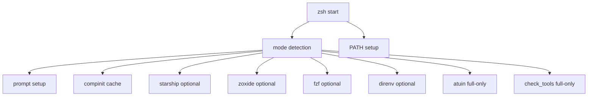

Zsh Runtime Hardening Notes

Scope

This document describes TASK-002: zsh runtime hardening for latency-sensitive shell startup.

Runtime modes

- `minimal` — lowest latency; skips optional integrations and diagnostics.
- `normal` — default local workflow; loads common interactive integrations.
- `full` — explicit override; loads all integrations and diagnostics even in environments that would normally downgrade to minimal.

Remote-aware behavior

- SSH, CI, and nested tmux sessions are treated as latency-sensitive and automatically downgrade from `normal` to `minimal` unless `DOTFILES_SHELL_MODE=full` is explicitly set.
- Non-interactive shells still exit early per the standard zsh guard.

Initialization graph



Startup timing table

| Mode | Median startup (ms) | Notes |
|---|---:|---|
| default before TASK-002 | 81 | first-cold run was 378 ms |
| minimal | 68 | deterministic prompt, no optional integrations |
| default after hardening | 76 | normal path remains stable after cache/mode cleanup |

Component timing snapshot (zprof)

| Component | Time (ms) | Comment |
|---|---:|---|
| compinit | 15.91 | dominates zsh init cost |
| compaudit | 7.83 | security check and cache validation |
| add_to_path | 0.03 | negligible |
| is_minimal_shell | 0.00 | negligible |

Policy changes

- Stable compdump cache path: `${XDG_CACHE_HOME:-$HOME/.cache}/zsh/zcompdump-$ZSH_VERSION`
- Cache corruption recovery: if `compinit` fails, remove the dump and retry once.
- PATH deduplication: `typeset -U path PATH` ensures repeated sources do not accumulate duplicates.
- Diagnostics (`check_tools`) are only run in `full` mode.

Migration notes

- Existing behavior is preserved as `normal` for local interactive use.
- Set `DOTFILES_SHELL_MODE=minimal` for SSH, CI, or deep-focus sessions.
- Set `DOTFILES_SHELL_MODE=full` if you explicitly want the complete toolchain and diagnostics.

Rollback

- Revert `zsh/.zshrc` to the previous revision if the new mode logic is not desired.
- The change is isolated and does not alter shell aliases or editor defaults.

Benchmark commands

```bash
bash bench/zsh_startup.sh
DOTFILES_SHELL_MODE=minimal bash bench/zsh_startup.sh
```

Interpretation

- Use median startup as the primary score.
- Treat sub-20 ms component changes with absolute thresholds in regression policy to avoid the microbenchmark trap.
